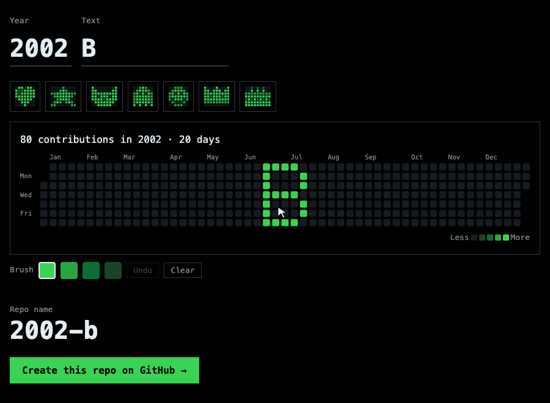

# gh-profile-kit

Paint text or pixel art into a past year of your GitHub contribution graph.

**English** · [中文](README.zh-CN.md)

### [Open the painter →](https://theowang42.github.io/gh-profile-kit/)

## Three clicks

1. Pick a year. Type, click a shape, or draw.
2. Click **Create this repo on GitHub**.
3. Click **Create repository**.

About a minute later, that year on your profile shows the drawing.

## Safe by design

- **Past years only.** 1970 to last year. Today's square is never touched.
- **One painting, one repo.** Undo: delete the repo. The graph may take a while to update.
- **Nothing to install, nothing to grant.** No login, no token, no server. It can only write to the repo it lives in.
- **Readable.** About 120 lines of Python. Actions pinned to commit hashes. MIT licensed.

## Profile page

1. **Use this template**. Name the repo exactly your username. Public.
2. Edit `profile.toml`.

---

Inspired by [gitfiti](https://github.com/gelstudios/gitfiti).
