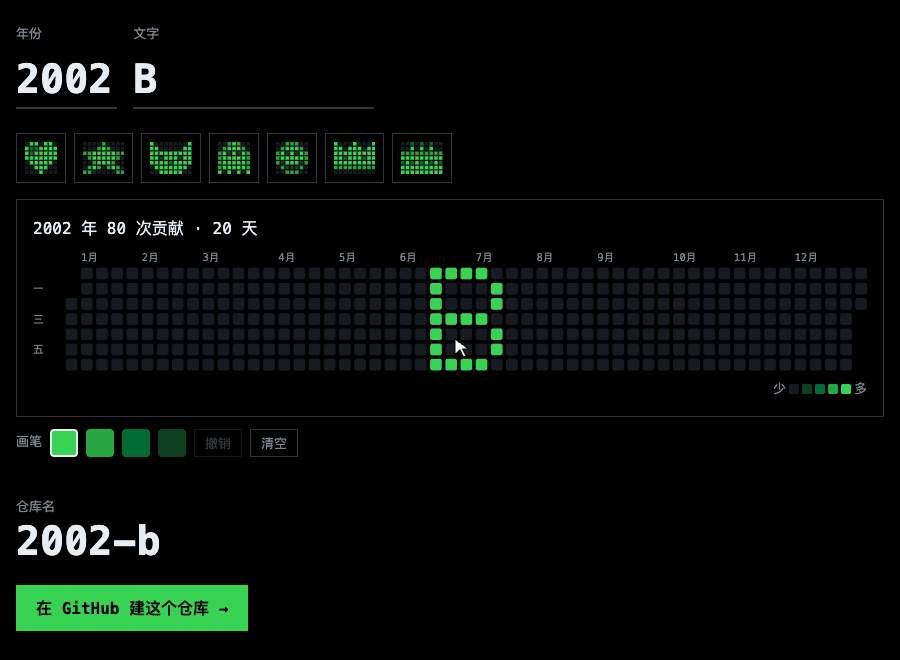

# Paint your GitHub graph

在 GitHub 格子的过去某一年，画字或像素画。

[English](README.md) · **中文**

### [打开画板 →](https://theowang42.github.io/paint-your-github-graph/)

## 点三下

1. 选年份。打字、点预设或手画。
2. 点 **在 GitHub 建这个仓库**。
3. 点 **Create repository**。

约一分钟后，主页上那一年就是你的画。

## 安全

> **这是彩蛋，不是工作记录。** 请勿用来伪造主页工作量。每个画出来的仓库，README 里都会写明这一点。

- **只画过去。** 1970 年到去年，不碰今天的格子。
- **一幅画一个仓库。** 撤销：删掉仓库。格子可能要过一阵才更新。
- **不用装，不用授权。** 不登录，不要 token，没有服务器。它只能写自己所在的仓库。
- **看得懂。** Python 约 120 行。Actions 锁定到提交哈希。MIT 许可。

## 主页

1. **Use this template**，仓库名和你的用户名一样，Public。
2. 改 `profile.toml`。

---

灵感来自 [gitfiti](https://github.com/gelstudios/gitfiti)。
